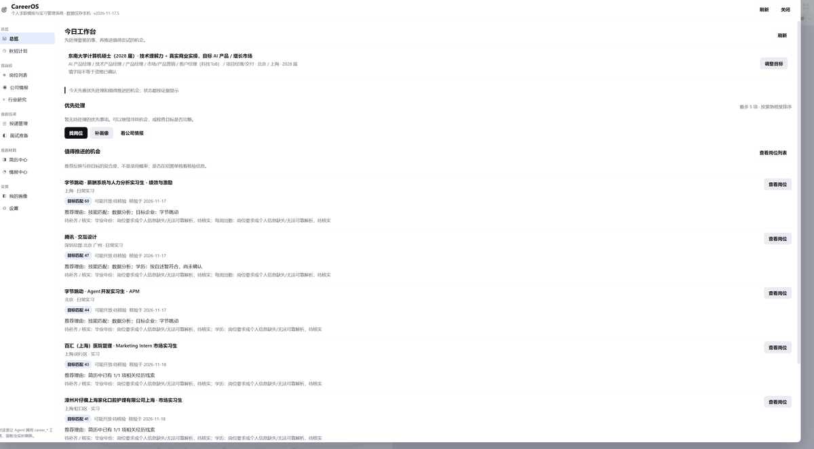

# CareerOS

CareerOS 是一个求职管理工作台，作为 DeepSeek Harness 插件运行。岗位、面经、简历和投递记录都存在本机 SQLite，面板和对话共用同一份数据。

- **岗位**：粘贴 JD 或按公司抓取，每条记录带来源、时间和可信度
- **投递**：首次正式投递时冻结当次 JD 与简历版本，之后可以回放
- **面经**：按年份、部门、样本量归类；没有证据的地方留空



## 环境

- DeepSeek Harness（桌面版）
- Windows 10 及以上（本地图片 OCR 依赖系统 OCR 引擎）
- 可选：XeLaTeX（把简历编译成 PDF）、Python 3（安装 PDF 解析依赖）

## 安装

1. 仓库放到任意目录，例如 `D:\career_os`
2. 在 DSH 插件列表启用 `dsh-career`
3. 首次安装运行一次：

```powershell
node scripts\setup-runtime.mjs
```

4. 侧边栏底部出现「🎯 求职面板」，点开即可使用

## 使用

1. **简历中心** 导入简历：PDF / Word / Markdown，或直接粘贴文本
2. **我的画像** 填可实习时间、每周天数、目标城市与岗位；留空表示未知，不会自动推断
3. **找岗位** 粘贴 JD，或让我按公司抓取；点开 Job360 看匹配、公司与申请准备
4. **我的投递** 加入投递、推进状态；日历里看未来 30 天的截止和跟进
5. **情报中心** 浏览与检索面经和资料，可关联回具体岗位

所有数据在 `data/career.db`。不代投、不发消息、不上传简历原文。

## 对话里能做什么

| 说法 | 结果 |
| --- | --- |
| 我现在算秋招什么阶段，接下来该干什么 | 按毕业年份推算批次，结合画像、岗位池和在投数给动作清单 |
| 帮我看看现在该投什么 | 按已核验状态、JD 完整度、匹配度排序，并说明理由 |
| 这个岗位是真的在招吗 | 校验官方来源与摘录；拿不出证据就直说 |
| 我的简历和这个岗位差在哪 | 逐条对比 JD 要求与已有素材，缺什么列什么 |
| 研究一下这家公司值不值得去 | 汇总在库岗位、部门、公开资料与经验样本，标来源和时间 |
| 帮我准备面试 | 公司背景、JD 知识点、真实面经、可能的追问 |

## 抓取

按以下顺序尝试，前一环不通才走后一环：

1. 已知招聘系统的公开接口（Lever / Greenhouse / Ashby / SmartRecruiters）
2. 页面里的 `schema.org` JobPosting 或内嵌 JSON
3. 你用专用浏览器登录后，捕获页面自己发出的请求
4. 都拿不到时返回「抓不到」，并给到具体页面的取数指引

不破解签名、不绕过登录、不并发撞接口。大厂校招站多为前端渲染，未登录时只能拿到取数指引。

## 状态与证据

页面能打开不等于还在招，所以状态单独判断：

- 官方链接 + 原文摘录 → `已核验开放`
- 历史 OPEN 但没有当前证据 → `可能开放·待核验`
- 超过 7 天未复核 → `信息已过期`

匹配分表示与已填画像的贴合度，不是录用概率，也不与招聘状态混在一起。

## 开发

```powershell
npm test                        # 全部回归，当前 457 项
node scripts\build-client.mjs   # 改过 client/parts 后重新打包
```

改 Host 代码后重载插件：`plugin_manager set_plugin enabled=false/true target=include:dsh-career`。

重新生成 README 里的 GIF：打开面板分别截图到 `.tmp/gui/`，然后 `python scripts\make-demo-gif.py`。

## 文档

- [快速上手](docs/QUICKSTART.md)
- [交付报告（含未完成项）](docs/V2-DELIVERY.md)
- [架构与技术决策](docs/architecture.md)
- [数据模型与状态机](docs/data-model.md)
- [数据源政策与合规边界](docs/source-policy.md)
- [状态清单](docs/STATUS.md)

## 已知限制

- 面板的四屏宽、亮暗主题走查尚未做，视觉问题以实际使用反馈为准
- 申请自定义状态、批量操作、研究任务跨重启续跑未实现
- 招聘平台与论坛依赖登录态，过期需要重新登录
- schema v14，无迁移工具；换机器需复制 `data/` 或重新导入

`data/` 与 `runtime/` 不入库，里面是真实简历、联系方式和浏览器登录态。
