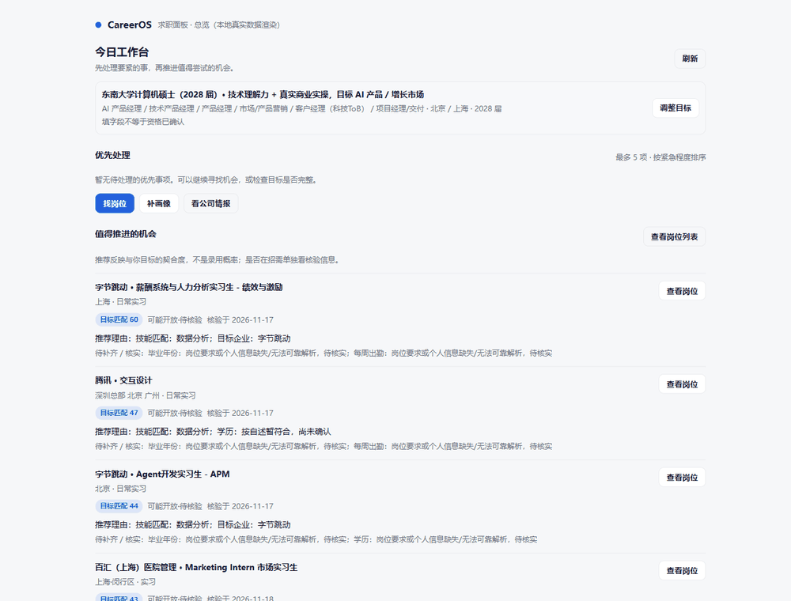

# CareerOS

求职过程的工作台：把岗位、面经、简历和投递记录放进同一个本地库，用证据而不是印象做判断。

它是 DeepSeek Harness 的插件。装好之后侧边栏多一个「求职面板」，对话里也能直接让它找岗位、核验状态、准备面试。



> 上图是面板「总览」用本机真实数据渲染的结果，不含 DSH 外壳；完整的点击走查需要你在本机跑一遍。

## 它想解决什么

找工作真正难的不是投得多，而是三件事没人替你记：

- **这个岗位现在还在招吗。** 页面能打开不等于还在招，第三方转载的「在招」常常是旧信息。
- **我投的时候它写的是什么要求。** 岗位下架、被改要求之后，面试前一天你还答得上来吗。
- **这条面经说的是哪一年、哪个部门。** 不同年份、不同部门的经验混成一条结论，就是假规律。

CareerOS 把这三件事做成可回放的记录：状态带来源与摘录，投递冻结当时的 JD 与材料，面经观点带年份、部门与样本量。

## 开始使用

1. 侧边栏底部点「求职面板」。
2. 「我的材料 → 简历中心」导入简历（PDF / Word / Markdown，或直接粘贴文本）。
3. 「我的画像」补齐可实习时间、每周天数、目标城市与岗位。留空就是未知，系统不会替你猜。
4. 「找岗位」粘贴 JD，或让我按公司去抓；选中岗位打开 Job360 看匹配、公司与申请准备。
5. 「我的投递」推进状态，日历里看未来 30 天的截止与跟进。

数据都在本机 `data/career.db`。不代投、不替你发消息、不把简历原文传出去。

## 面板

| 工作区 | 做什么 |
| --- | --- |
| 总览 | 今天该处理的事：最多 5 条，带理由；可完成、稍后、忽略 |
| 找岗位 | 全库筛选与分页、紧凑表格/卡片、最多 5 个岗位逐字段对比 |
| 我的投递 | 清单 / 看板 / 日历三种视图，逾期跟进单列 |
| 我的材料 | 简历中心（版本、素材、LaTeX）、情报中心（面经与资料）、个人画像 |
| 设置 | 数据源健康、登录入口、采集与 OCR |

## 能做的事

- **岗位**：粘贴 JD 自动解析；按公司抓取并做 7 天 diff；同一岗位多来源自动合并，官方来源优先。
- **状态核验**：官方链接 + 原文摘录才能标为已核验开放；历史「OPEN」没有当前证据时显示「可能开放·待核验」；超过 7 天自动转「信息已过期」。
- **匹配解释**：资格（Eligibility）、匹配度（Fit）、证据质量（Evidence）分开算，不揉成一个总分；匹配分只表示与你提供材料的贴合度，不是录用概率。
- **面试准备**：真实面经与 AI 练习严格分区；观点按年份与部门聚合，样本不足只作线索，相反说法标为冲突。
- **投递凭据**：首次正式投递冻结 JD 与所用简历版本；同公司 6 个月内重复投递会提醒；漏斗统计卡在哪一关。
- **采集与 OCR**：复用你自己的登录态只读页面自身请求；图片用本机 Windows OCR 识别，结果一律待你核对。

## 常用说法

| 你说 | 会发生什么 |
| --- | --- |
| 我现在算秋招什么阶段，接下来该干什么 | 按毕业年份推算批次，并结合画像、岗位池、在投给动作清单 |
| 帮我看看现在该投什么 | 按已核验状态、JD 完整度、匹配度排序并说明理由 |
| 这个岗位是真的在招吗 | 校验官方来源与摘录；给不出证据就说给不出 |
| 我的简历和这个岗位差在哪 | 逐条对比 JD 要求与已有素材，缺什么列什么 |
| 研究一下这家公司值不值得去 | 汇总在库岗位、部门、公开资料与经验样本，标明来源与时间 |
| 帮我准备面试 | 公司背景、JD 知识点、真实面经、可能追问 |

## 抓取边界

大厂校招站多为前端渲染，页面源码里没有岗位数据。所以顺序是：已知招聘系统的公开接口 → 结构化数据（JSON-LD / 内嵌 JSON）→ 你用登录态捕获页面自身请求 → 都不行就明确说抓不到，并给到具体页面的取数指引。

不会破解签名、不绕过登录、不批量撞接口，也**不会编造岗位**。抓不到时宁可告诉你抓不到，也不拿标题凑数。

## 文档

- [使用指南](docs/QUICKSTART.md)
- [v2 交付报告（含未完成项）](docs/V2-DELIVERY.md)
- [架构与技术决策](docs/architecture.md)
- [数据模型与状态机](docs/data-model.md)
- [数据源政策与合规边界](docs/source-policy.md)
- [状态清单](docs/STATUS.md)

## 开发

```powershell
npm test                       # 全部回归（当前 457 项）
node scripts\build-client.mjs  # 改过 client/parts 后重新生成 bundle
node scripts\setup-runtime.mjs # 首次装上 PDF 解析依赖

# 重新生成 README 里的演示 GIF（用本机 data 真实数据渲染）
node scripts\make-demo-gif.mjs
python scripts\make-demo-gif.py
```

改 Host 代码后重载插件：`plugin_manager set_plugin enabled=false/true target=include:dsh-career`。

`data/` 与 `runtime/` 不入库（含真实简历与联系方式）。

## 现状

schema v14 · 85 个 Agent 工具 · 11 个页签（5 组导航）。

已实现部分有离线回归与真实采集记录作为依据；GUI 的视觉与四屏宽走查尚未执行，P1–P3 中的申请自定义状态、批量操作、研究任务自动续跑仍未完成，明细见[交付报告](docs/V2-DELIVERY.md)。
